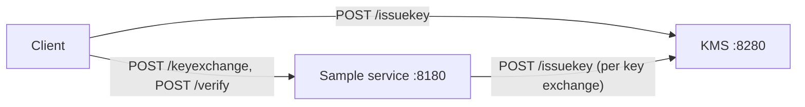

# **P2PE Framework**

The code provides a design pattern for application level encryption between services using the JOSE standards.
This can be used as a start point for handling of sensitive data between services on top of using TLS1.2
It uses the Nimbus library for the digital signature and encryption and utilizes JWKS/JWK/JWE/JWS standards.
It uses DropWizard for the services. 

**Setup**
1. KMS - The key management service that hosts the JWKS end point that all services connect to at startup and get the signing and encryption keys.
2. Client and Server communicate with each other using the security apparatus.
3. Server starts and waits for client connection
4. Client starts and gets the keys from KMS 
5. Client initiates keyexchange with the server and sends it its public keys.
6. Server gets its keys from KMS and sends it's public keys to the client
7. At this point setup is complete and both parties have each others public keys.
8. Both sides will use the other's public key and use DiffieHellman to derive the shared secret. 
9. Each message will use an ephemeral keypair and the other parties public key to derive the shared secret.This actual work is done by the Nimbus library.
10. The message sent has the following format JWE<JWS<Message>> and the other party first decrypts the message and then verifies the signature before processing the message.
11. Replay protection: every request carries a fresh random nonce and a timestamp (`nonce` and `iat`) in the signed JWS header. The server rejects a nonce it has already seen in that session, or a timestamp more than 5 minutes off. The response echoes the request's nonce, and the client rejects a response whose nonce doesn't match.
12. Server implements two Rest end points - one for keyexchange and one for processing the message.

**Exclusions**
The pattern does not cater to the following areas, which would need to be provided by alternate mechanisms.
1. Mutual authentication between services
2. Service discovery 
3. Long term key storage 
4. Does not use certificates for validating public keys

**Build & Run**

Requires Java 26 and Maven 3.9+. Run the commands from the project root.

The TLS keystore is not in the repository. The servers read its path and password from the `P2PE_KEYSTORE_PATH` and `P2PE_KEYSTORE_PASSWORD` environment variables and refuse to start without them. For local development, generate a self-signed `localhost` keystore and a certificate-only truststore (both gitignored) once:

```
export P2PE_KEYSTORE_PASSWORD='<choose one>'
export P2PE_KEYSTORE_PATH=dev/dev-keystore.p12
dev/generate-dev-keystore.sh
```

Then:

```
mvn package
TRUST="-Djavax.net.ssl.trustStore=dev/dev-truststore.p12 -Djavax.net.ssl.trustStorePassword=$P2PE_KEYSTORE_PASSWORD"
java -cp target/P2PE-1.0-SNAPSHOT.jar kms.KMSApplication server src/main/resources/kms.yml
java $TRUST -cp target/P2PE-1.0-SNAPSHOT.jar service.SampleApplication server src/main/resources/sample.yml
java $TRUST -cp target/P2PE-1.0-SNAPSHOT.jar client.Client
```

In production, point `P2PE_KEYSTORE_PATH` at a keystore issued by your CA, and give clients a truststore holding that CA. The admin ports (8181, 8281) listen on `127.0.0.1` only.

<!-- BEGIN: generated-docs-summary -->
## Code Overview

P2PE has three runnable parts, which use a sign-then-encrypt envelope (**JWE&lt;JWS&lt;payload&gt;&gt;**, ES256 signatures, ECDH-ES + A256GCM encryption) on top of HTTPS:

- `kms.KMSApplication` (port 8280): issues fresh EC P-256 key pairs.
- `service.SampleApplication` (port 8180): handshake plus encrypted echo endpoint.
- `client.Client`: demo that runs the whole flow once.



**Flow:**
1. The client gets its keys from the KMS.
2. `/keyexchange` swaps public keys. The service fetches its own keys from the KMS and caches the session under its ECDH key ID.
3. `/verify` carries messages signed by the client and encrypted to the service. The service decrypts, verifies, processes (echo), then signs and encrypts the reply back.

All crypto lives in `util/JWUtil.java`. Server-side session handling is `util/KeyExchangeUtil.java` → `util/ClientHandler.java` → `util/ClientManager.java`, and the client side is `util/ServiceConnector.java`.

**Build & run:** `mvn package`, then start the KMS, the service and the client as shown in *Build & Run* above. Run from the repository root.

For per-file and per-function documentation, the full file index and known issues, see [docs/OVERVIEW.md](docs/OVERVIEW.md).
<!-- END: generated-docs-summary -->
