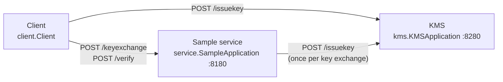
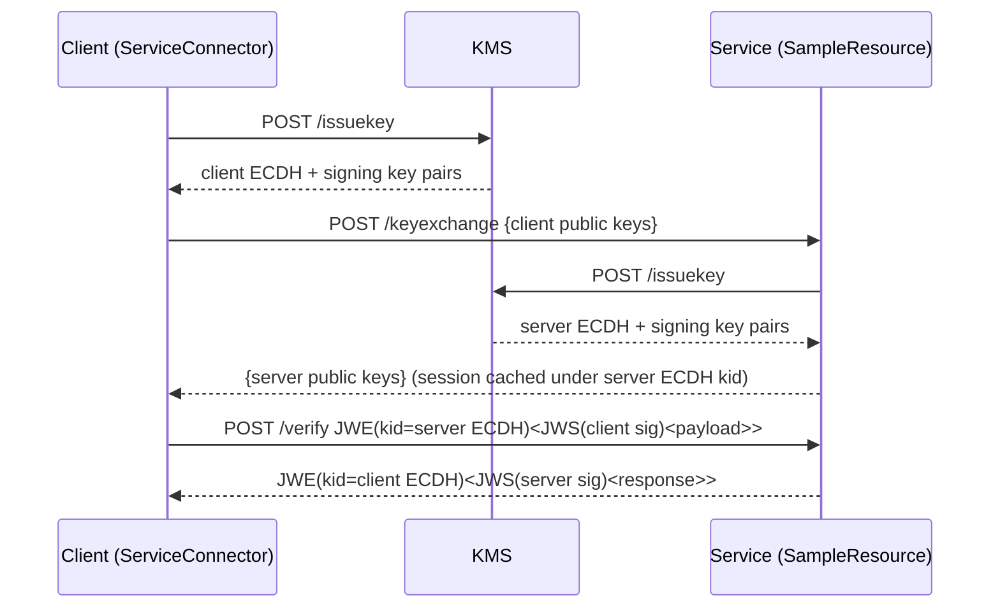

# P2PE — Code Overview

## What this project is

P2PE is a reference implementation of **application-level encryption between services**, built on top of TLS with the JOSE standards (JWK, JWS, JWE) via the Nimbus library. Every message is signed by the sender (ES256) and then encrypted to the recipient (ECDH-ES + A256GCM), giving a **JWE&lt;JWS&lt;payload&gt;&gt;** envelope. The repo contains three runnable pieces: a toy key-management service (KMS), a sample service, and a demo client. All are Java 26, and the two servers run on Dropwizard 5.

## Architecture



- **KMS** ([`KMSResource.java`](src/main/java/kms/KMSResource.java.md)) generates two fresh EC P-256 key pairs per request, one for key agreement and one for signing, and returns them **including the private keys**. Nothing is stored.
- **Sample service** ([`SampleResource.java`](src/main/java/service/SampleResource.java.md)) does the handshake and then processes encrypted requests. It keeps one in-memory session per client ([`ClientCache.java`](src/main/java/util/ClientCache.java.md) → [`ClientHandler.java`](src/main/java/util/ClientHandler.java.md)).
- **Client** ([`Client.java`](src/main/java/client/Client.java.md)) gets its keys from the KMS, then talks to the service through [`ServiceConnector.java`](src/main/java/util/ServiceConnector.java.md).
- **Shared utilities:** all crypto is in [`JWUtil.java`](src/main/java/util/JWUtil.java.md). HTTPS calls go through [`Connection.java`](src/main/java/util/Connection.java.md) and JSON through [`JSONUtil.java`](src/main/java/util/JSONUtil.java.md).

## Key flows



1. **Key issuance:** the client calls `KMSConnector.getKAandSignPubKeys`, which reaches `KMSResource.issueKey` → `JWUtil.createKey` ×2.
2. **Key exchange:**
   - `ServiceConnector.init` posts the client's public keys to `/keyexchange`.
   - On the server, `KeyExchangeUtil.keyExchange` creates a `ClientHandler`. `ClientHandler.init` fetches server keys from the KMS and parses the client's keys.
   - The handler is cached under the server ECDH key's `kid`, and the server's public keys are returned.
3. **Encrypted request:**
   - `ServiceConnector.send` → `JWUtil.signAndEncrypt` → `POST /verify`.
   - Server: `ClientManager.process` reads the JWE `kid`, finds the session, then calls `ClientHandler.unwrap` (`JWUtil.decryptAndVerify`), `SampleRequestProcessor.process` (echo) and `ClientHandler.wrap`.
   - Client: `ServiceConnector.unwrapResponse` decrypts and verifies the reply and checks that it echoes the request nonce.
   - Replay protection: each request's signed JWS header carries a fresh `nonce` and an `iat` timestamp. `ClientHandler.unwrap` passes them to the session's [`NonceCache`](src/main/java/util/NonceCache.java.md), which rejects repeated nonces and timestamps more than 5 minutes off.
4. **Errors:** a malformed JWE, an unknown session, or a failed decryption or signature check returns HTTP 400. A KMS outage during the key exchange returns HTTP 500.

## Directory / module map

| Package / path | Responsibility |
|---|---|
| `src/main/java/client` | Demo client entry point. |
| `src/main/java/kms` | KMS Dropwizard app, config and `/issuekey` resource. |
| `src/main/java/service` | Sample service Dropwizard app, config, resource and the echo processor. |
| `src/main/java/common` | Shared Dropwizard config base and the `Processor` interface. |
| `src/main/java/data` | JSON request/response beans. |
| `src/main/java/util` | Crypto (`JWUtil`), HTTP/JSON helpers, client and server session logic. |
| `src/main/resources` | Dropwizard YAML configs (keystore path and password come from environment variables). |
| `dev` | `generate-dev-keystore.sh`, which creates the gitignored local dev keystore and truststore. |
| `src/test/java` | Unit tests for `JWUtil`, `NonceCache`, `ClientHandler` and `ClientCache` plus exploratory Nimbus examples. |

## File index

| File | Purpose |
|---|---|
| [`pom.xml`](pom.xml.md) | Maven build: Java 26, dependencies, shaded uber jar. |
| [`client/Client.java`](src/main/java/client/Client.java.md) | Demo client running the full flow once. |
| [`common/AppConfiguration.java`](src/main/java/common/AppConfiguration.java.md) | Shared Dropwizard config (`template`, `defaultName`). |
| [`common/Processor.java`](src/main/java/common/Processor.java.md) | Interface for server-side business logic. |
| [`data/EncryptedSignedMessage.java`](src/main/java/data/EncryptedSignedMessage.java.md) | Base bean holding the JWE string. |
| [`data/EncryptedSignedRequest.java`](src/main/java/data/EncryptedSignedRequest.java.md) | `/verify` request body. |
| [`data/EncryptedSignedResponse.java`](src/main/java/data/EncryptedSignedResponse.java.md) | `/verify` response body. |
| [`data/KeyExchange.java`](src/main/java/data/KeyExchange.java.md) | `/keyexchange` body (public keys). |
| [`data/KeyRequest.java`](src/main/java/data/KeyRequest.java.md) | `/issuekey` request body (unused field). |
| [`data/KeyResponse.java`](src/main/java/data/KeyResponse.java.md) | `/issuekey` response (private JWKs). |
| [`kms/KMSApplication.java`](src/main/java/kms/KMSApplication.java.md) | KMS entry point. |
| [`kms/KMSConfiguration.java`](src/main/java/kms/KMSConfiguration.java.md) | KMS config type. |
| [`kms/KMSResource.java`](src/main/java/kms/KMSResource.java.md) | `POST /issuekey`. |
| [`service/SampleApplication.java`](src/main/java/service/SampleApplication.java.md) | Sample service entry point. |
| [`service/SampleConfiguration.java`](src/main/java/service/SampleConfiguration.java.md) | Sample service config type. |
| [`service/SampleRequestProcessor.java`](src/main/java/service/SampleRequestProcessor.java.md) | Echo business logic. |
| [`service/SampleResource.java`](src/main/java/service/SampleResource.java.md) | `POST /keyexchange`, `POST /verify`. |
| [`util/ClientCache.java`](src/main/java/util/ClientCache.java.md) | Server session store (kid → handler). |
| [`util/ClientHandler.java`](src/main/java/util/ClientHandler.java.md) | One server-side session: keys + wrap/unwrap. |
| [`util/ClientManager.java`](src/main/java/util/ClientManager.java.md) | Server pipeline for one encrypted request. |
| [`util/Connection.java`](src/main/java/util/Connection.java.md) | HTTPS JSON POST client. |
| [`util/JSONUtil.java`](src/main/java/util/JSONUtil.java.md) | Jackson helpers. |
| [`util/JWUtil.java`](src/main/java/util/JWUtil.java.md) | Key generation, JWE/JWS, sign+encrypt envelope. |
| [`util/NonceCache.java`](src/main/java/util/NonceCache.java.md) | Per-session replay guard (nonce + timestamp window). |
| [`util/KeyExchangeUtil.java`](src/main/java/util/KeyExchangeUtil.java.md) | Server-side key-exchange handshake. |
| [`util/KMSConnector.java`](src/main/java/util/KMSConnector.java.md) | Client for the KMS. |
| [`util/ServiceConnector.java`](src/main/java/util/ServiceConnector.java.md) | Client side of a session. |
| [`util/VerifiedMessage.java`](src/main/java/util/VerifiedMessage.java.md) | Verified payload + nonce + timestamp. |
| [`resources/kms.yml`](src/main/resources/kms.yml.md) | KMS config (ports 8280/8281). |
| [`resources/sample.yml`](src/main/resources/sample.yml.md) | Service config (ports 8180/8181). |
| [`test/NimbusFeaturesTest.java`](src/test/java/NimbusFeaturesTest.java.md) | Exploratory Nimbus examples. |
| [`test/util/JWUtilTest.java`](src/test/java/util/JWUtilTest.java.md) | Tests for the crypto envelope. |
| [`test/util/NonceCacheTest.java`](src/test/java/util/NonceCacheTest.java.md) | Tests for the replay guard. |
| [`test/util/ClientHandlerTest.java`](src/test/java/util/ClientHandlerTest.java.md) | Replay rejection and nonce echo for a session. |

## Build, run, test

You need Java 26 and Maven 3.9+. Run everything **from the repository root**. The servers need `P2PE_KEYSTORE_PATH` and `P2PE_KEYSTORE_PASSWORD` set and refuse to start otherwise.

```bash
mvn package          # compiles, runs tests, builds target/P2PE-1.0-SNAPSHOT.jar (uber jar)
mvn test             # tests only

export P2PE_KEYSTORE_PASSWORD='<choose one>' P2PE_KEYSTORE_PATH=dev/dev-keystore.p12
dev/generate-dev-keystore.sh   # once: creates dev/dev-keystore.p12 and dev/dev-truststore.p12

JAR=target/P2PE-1.0-SNAPSHOT.jar
TRUST="-Djavax.net.ssl.trustStore=dev/dev-truststore.p12 -Djavax.net.ssl.trustStorePassword=$P2PE_KEYSTORE_PASSWORD"

java -cp $JAR kms.KMSApplication server src/main/resources/kms.yml               # KMS on https://localhost:8280
java $TRUST -cp $JAR service.SampleApplication server src/main/resources/sample.yml  # service on https://localhost:8180
java $TRUST -cp $JAR client.Client                                                # prints "Hello World Request"
```

- **Ports:**
  - KMS: 8280 (API) and 8281 (admin).
  - Service: 8180 (API) and 8181 (admin).
  - All HTTPS. The admin ports listen on `127.0.0.1` only, because the admin endpoints have no authentication.
- **TLS:** `dev/generate-dev-keystore.sh` creates a self-signed EC certificate for `localhost` per developer. Clients trust `dev-truststore.p12`, which holds only the certificate, not the private key. The service and the client need the trust-store flags because both make HTTPS calls; the KMS only serves. Hostname verification is on.
- **Start order:** KMS first, then the service, then the client. The service needs the KMS for every key exchange.
- **Tests:** 25 tests; `NimbusFeaturesTest.test1` is skipped unless its external PEM files exist.

## Known issues & caveats

- **The KMS issues private keys to anyone:** no authentication, and private JWKs are returned over the network ([`KMSResource.java`](src/main/java/kms/KMSResource.java.md), [`KeyResponse.java`](src/main/java/data/KeyResponse.java.md)).
- **Sessions are in memory:** [`ClientCache.java`](src/main/java/util/ClientCache.java.md) holds at most 10,000 sessions, which expire after 30 minutes idle or 24 hours in total. They don't survive a restart, and `/keyexchange` has no rate limiting.
- **Replay protection is per session and in memory:** each session's [`NonceCache`](src/main/java/util/NonceCache.java.md) only remembers nonces for the 5-minute window and is lost on restart. Replay across sessions isn't possible, because each session has its own keys. The `/keyexchange` call has no nonce, because it isn't authenticated anyway (see the README's exclusions).
- **Hard-coded endpoints:** `https://localhost:8280/` in [`KMSConnector.java`](src/main/java/util/KMSConnector.java.md) and `https://localhost:8180/` in [`Client.java`](src/main/java/client/Client.java.md).
- **Low-level helpers return `null` or empty on failure:** [`JWUtil.java`](src/main/java/util/JWUtil.java.md) and [`JSONUtil.java`](src/main/java/util/JSONUtil.java.md) print stack traces and return `null` or empty instead of throwing. Only `decryptAndVerify` turns failures into exceptions.
- **Unused leftovers from the Dropwizard template:**
  - The `template` / `defaultName` config values are required but never used ([`AppConfiguration.java`](src/main/java/common/AppConfiguration.java.md)).
  - `KeyRequest.clientName` is never set or read.
  - `JSONUtil.toPrettyJSON` is unused.
- **Noisy stdout logging:** HTTP responses, JWE headers and key IDs are printed with `System.out` rather than a logger. Decrypted payloads are no longer logged, and rejected `/verify` requests are logged at WARN by [`ClientManager.java`](src/main/java/util/ClientManager.java.md).
- **Security audit:** see [`security/OWASP-AUDIT.md`](../security/OWASP-AUDIT.md) for the OWASP Top 10 findings, including the ones still open.
